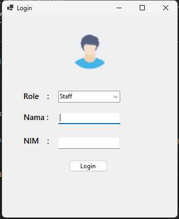
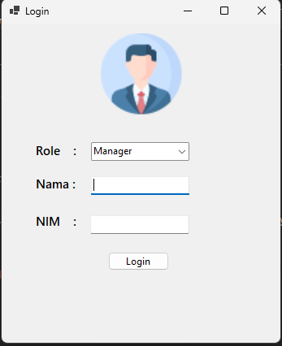
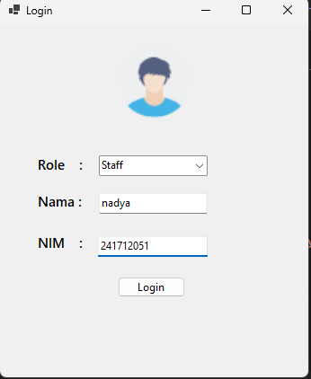
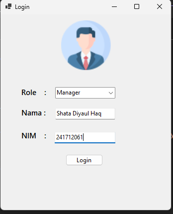
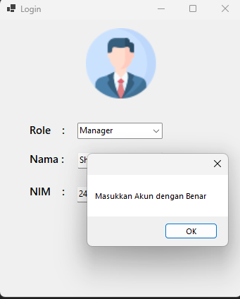
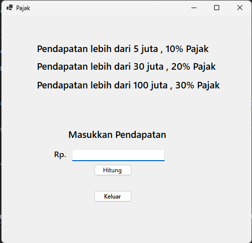

# Tugas 1 — Aplikasi Login dan Perhitungan Pajak

## Deskripsi

Buatlah aplikasi desktop menggunakan **VB.NET Windows Forms** yang memiliki dua form utama:

1. **Form Login**, untuk memvalidasi pengguna berdasarkan role, nama, dan NIM.
2. **Form Pajak**, untuk menghitung pajak berdasarkan jumlah pendapatan.

Aplikasi harus memiliki tampilan dan alur kerja yang menyerupai contoh yang diberikan. Gunakan penamaan kontrol, event, dan validasi yang konsisten agar program mudah diperiksa.

> **Catatan:** Gambar pada instruksi ini merupakan referensi tampilan dan kondisi aplikasi, bukan kode program yang dapat disalin.

## Tujuan Pembelajaran

Setelah menyelesaikan tugas ini, mahasiswa diharapkan mampu:

- membuat project Windows Forms menggunakan VB.NET;
- merancang form menggunakan komponen visual pada Toolbox;
- mengatur properti komponen melalui Windows Forms Designer;
- menggunakan `TextBox`, `ComboBox`, `PictureBox`, `Label`, dan `Button`;
- menangani event `SelectedIndexChanged`, `Click`, dan `KeyPress`;
- melakukan validasi input teks dan angka;
- menerapkan percabangan `If...Then...ElseIf...Else`;
- menggunakan method seperti `Show`, `Hide`, `Close`, `Clear`, dan `Focus`;
- menampilkan informasi atau hasil menggunakan `MessageBox`.

## Ketentuan Umum

1. Gunakan **Visual Basic .NET Windows Forms**.
2. Buat satu project dengan nama yang mencerminkan tugas, misalnya `Tugas1_NIM_Nama`.
3. Buat dua form berikut:
   - `FrmLogin`
   - `FrmPajak`
4. Form yang pertama kali ditampilkan adalah `FrmLogin`.
5. Gunakan nama kontrol sesuai tabel pada bagian spesifikasi. Jika menggunakan nama berbeda, sertakan pemetaan nama kontrol pada laporan.
6. Gunakan gambar yang tersedia pada folder `Image` sebagai referensi atau aset aplikasi.
7. Jangan menggunakan database. Data akun boleh disimpan langsung di dalam kode program.
8. Program harus dapat dijalankan tanpa error dan setiap tombol harus memiliki fungsi.

## A. Form Login

### Komponen yang wajib digunakan

| Komponen | Name | Fungsi |
|---|---|---|
| `PictureBox` | `picImage` | Menampilkan gambar sesuai role yang dipilih |
| `ComboBox` | `cmbRole` | Memilih role `Staff` atau `Manager` |
| `TextBox` | `txtNama` | Menerima input nama pengguna |
| `TextBox` | `txtNIM` | Menerima input NIM pengguna |
| `Button` | `btnLogin` | Memproses login |
| `Label` | `lblRole` | Label untuk role |
| `Label` | `lblNama` | Label untuk nama |
| `Label` | `lblNIM` | Label untuk NIM |

### Tampilan

Atur form login sehingga memiliki:

- judul form `Login`;
- `PictureBox` di bagian atas form;
- pilihan role menggunakan `ComboBox`;
- input nama dan NIM;
- tombol `Login`;
- susunan komponen rapi dan mudah dibaca.

Contoh referensi tampilan:

### Ketentuan role dan gambar

1. Isi `ComboBox` dengan pilihan:
   - `Staff`
   - `Manager`
2. Ketika pilihan role berubah, gambar pada `PictureBox` harus ikut berubah:
   - role `Staff` menggunakan gambar staff;
   - role `Manager` menggunakan gambar manager.
3. Implementasikan perubahan gambar pada event `SelectedIndexChanged` milik `cmbRole`.
4. Pastikan file gambar ditempatkan pada lokasi yang dapat diakses oleh aplikasi saat dijalankan.

### Validasi input

1. `txtNama` hanya boleh menerima huruf dan spasi.
2. `txtNIM` hanya boleh menerima angka.
3. Gunakan event `KeyPress` untuk membatasi karakter yang tidak sesuai.
4. Jika NIM bukan angka yang valid, login tidak boleh dilanjutkan dan fokus dikembalikan ke `txtNIM`.
5. Data input yang memiliki spasi di awal atau akhir harus diproses dengan benar.

### Data akun pengujian

Gunakan data berikut untuk menguji login:

| Role | Nama | NIM |
|---|---|---:|
| Staff | Nadya | 241712051 |
| Manager | Shata Diyaul Haq | 241712061 |

Validasi harus memeriksa **ketiga data**: role, nama, dan NIM. Kombinasi yang tidak sesuai harus dianggap gagal.

### Perilaku tombol Login

1. Jika data benar:
   - buka `FrmPajak` menggunakan method `Show`;
   - sembunyikan `FrmLogin` menggunakan method `Hide`;
   - kosongkan input nama dan NIM setelah proses login berhasil.
2. Jika data salah:
   - tampilkan pesan kesalahan menggunakan `MessageBox`;
   - jangan membuka `FrmPajak`;
   - pengguna tetap berada pada form login.

Contoh kondisi login dengan akun Staff:

Contoh kondisi login dengan akun Manager:

Contoh kondisi ketika akun tidak sesuai:

## B. Form Pajak

### Komponen yang wajib digunakan

| Komponen | Name | Fungsi |
|---|---|---|
| `Label` | `lblLimaJuta` | Menampilkan informasi ketentuan pajak pertama |
| `Label` | `lblTigaPuluhJuta` | Menampilkan informasi ketentuan pajak kedua |
| `Label` | `lblSeratusJuta` | Menampilkan informasi ketentuan pajak ketiga |
| `Label` | `lblPendapatan` | Petunjuk input pendapatan |
| `Label` | `lblRupiah` | Menampilkan prefix mata uang `Rp.` |
| `TextBox` | `txtPendapatan` | Menerima input pendapatan |
| `Button` | `btnHitung` | Menghitung pajak |
| `Button` | `btnKeluar` | Menutup form pajak dan kembali ke login |

### Tampilan

Form pajak harus memuat:

- informasi rentang atau ketentuan pajak;
- label `Rp.` dan input pendapatan;
- tombol `Hitung`;
- tombol `Keluar`.

Gunakan gambar berikut sebagai referensi tampilan:

### Ketentuan perhitungan

Terapkan aturan pajak berikut menggunakan tipe data numerik yang sesuai, misalnya `Decimal`:

| Pendapatan | Pajak |
|---|---:|
| Kurang dari atau sama dengan Rp5.000.000 | 0% |
| Lebih dari Rp5.000.000 sampai dengan Rp30.000.000 | 10% |
| Lebih dari Rp30.000.000 sampai dengan Rp100.000.000 | 20% |
| Lebih dari Rp100.000.000 | 30% |

Rumus umum:

`Pajak = Pendapatan × Persentase Pajak`

### Perilaku tombol Hitung

1. Baca nilai dari `txtPendapatan`.
2. Pastikan nilai tersebut berupa angka yang valid.
3. Jika input bukan angka:
   - tampilkan pesan peringatan menggunakan `MessageBox`;
   - kembalikan fokus ke `txtPendapatan`;
   - hentikan proses perhitungan.
4. Tentukan persentase pajak berdasarkan ketentuan pada tabel.
5. Tampilkan hasil pajak menggunakan `MessageBox`.
6. Format hasil sebagai nilai rupiah tanpa angka desimal, misalnya `Rp 1.000.000`.

### Validasi input pendapatan

- `txtPendapatan` hanya boleh menerima angka dan tombol kontrol seperti Backspace.
- Karakter huruf dan simbol yang tidak diperlukan harus ditolak.
- Uji input kosong, input huruf, nilai batas, dan nilai di atas batas tertinggi.

### Perilaku tombol Keluar

Ketika `btnKeluar` ditekan:

1. tutup `FrmPajak` menggunakan method `Close`;
2. tampilkan kembali `FrmLogin` menggunakan method `Show`.

## C. Event dan Method yang Wajib Ditunjukkan

Implementasikan minimal event berikut:

| Event | Kontrol | Tujuan |
|---|---|---|
| `SelectedIndexChanged` | `cmbRole` | Mengubah gambar berdasarkan role |
| `Click` | `btnLogin` | Memvalidasi akun dan membuka form pajak |
| `KeyPress` | `txtNama` | Membatasi input nama |
| `KeyPress` | `txtNIM` | Membatasi input NIM |
| `Click` | `btnHitung` | Menghitung dan menampilkan pajak |
| `KeyPress` | `txtPendapatan` | Membatasi input pendapatan |
| `Click` | `btnKeluar` | Kembali ke form login |

Program harus memperlihatkan penggunaan method berikut sesuai kebutuhan:

- `Show()`
- `Hide()`
- `Close()`
- `Clear()`
- `Focus()`
- `MessageBox.Show()`

## D. Skenario Pengujian Minimum

Buktikan bahwa program berhasil dengan menguji skenario berikut:

| No. | Skenario | Hasil yang diharapkan |
|---:|---|---|
| 1 | Memilih role Staff | Gambar Staff tampil |
| 2 | Memilih role Manager | Gambar Manager tampil |
| 3 | Login dengan akun Staff yang benar | Form pajak terbuka |
| 4 | Login dengan akun Manager yang benar | Form pajak terbuka |
| 5 | Nama, role, atau NIM tidak sesuai | Pesan kesalahan tampil |
| 6 | Memasukkan huruf pada NIM | Karakter ditolak |
| 7 | Memasukkan angka pada nama | Karakter ditolak |
| 8 | Pendapatan kosong atau bukan angka | Pesan peringatan tampil |
| 9 | Pendapatan Rp5.000.000 | Pajak 0% |
| 10 | Pendapatan Rp10.000.000 | Pajak 10% |
| 11 | Pendapatan Rp50.000.000 | Pajak 20% |
| 12 | Pendapatan Rp150.000.000 | Pajak 30% |
| 13 | Menekan tombol Keluar | Kembali ke form login |

