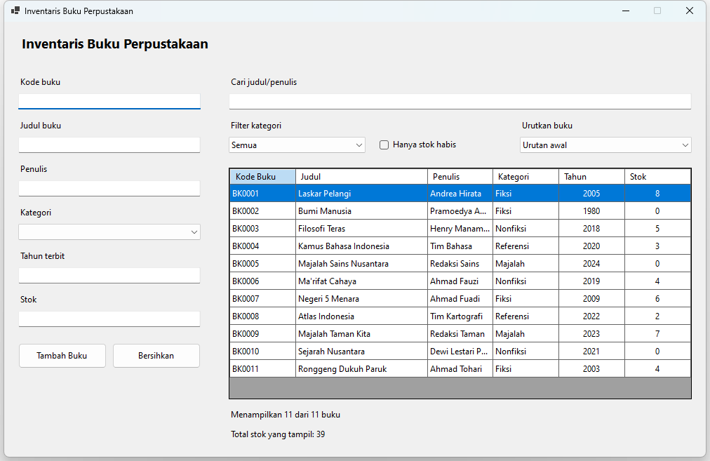

# Tugas Pertemuan 8: Inventaris Buku Perpustakaan

Mata kuliah Pemrograman Visual (TIF 3 031). Tugas individu.

## Deskripsi kasus

Setelah form peminjaman di Pertemuan 7, perpustakaan butuh tampilan inventaris: semua buku dalam satu tabel, lengkap dengan stoknya. Petugas ingin menambah buku baru, lalu mencari buku berdasarkan judul atau penulis sambil membatasi kategorinya. Contohnya, mencari "an" hanya di kategori Fiksi. Petugas juga ingin langsung melihat jumlah buku dan total stok dari hasil pencarian.

Buat aplikasi Windows Forms dengan satu form inventaris. Data disimpan di DataTable di memori, tanpa database.

Kasus ini berbeda dari contoh di kelas (data mahasiswa). Fitur yang belum dicontohkan: pencarian yang menggabungkan dua syarat sekaligus, pemeriksaan kode unik di dalam DataTable, dan total stok yang dihitung dari baris yang sedang tampil.

## Kontrol

| Kontrol | Nama | Keterangan |
|---|---|---|
| Label | lblJudulForm | Judul form "Inventaris Buku Perpustakaan" |
| TextBox | txtKodeBuku | Kode buku |
| TextBox | txtJudul | Judul buku |
| TextBox | txtPenulis | Penulis |
| ComboBox | cboKategori | DropDownList: Fiksi, Nonfiksi, Referensi, Majalah |
| TextBox | txtTahun | Tahun terbit |
| TextBox | txtStok | Jumlah stok |
| Button | btnTambah | Menambah buku |
| Button | btnBersihkan | Mengosongkan isian |
| TextBox | txtCari | Kata pencarian judul atau penulis |
| ComboBox | cboFilterKategori | DropDownList: Semua, Fiksi, Nonfiksi, Referensi, Majalah |
| DataGridView | dgvBuku | Tabel inventaris |
| BindingSource | bsBuku | Perantara DataTable dan dgvBuku |
| Label | lblJumlah | "Menampilkan X dari Y buku" |
| Label | lblTotalStok | Total stok dari buku yang sedang tampil |
| ErrorProvider | errBuku | Penanda isian yang salah |

Setiap TextBox dan ComboBox diberi Label keterangan dengan prefix `lbl`.

## Contoh tampilan

Tata letak boleh berbeda, asalkan semua kontrol pada tabel di atas ada dan namanya sesuai. Contoh ini sudah memuat dua tantangan tambahan (Urutkan buku dan Hanya stok habis). Keduanya tidak wajib.

Pada contoh kedua, pencarian "an" di kategori Fiksi menampilkan 2 dari 11 buku, dan total stoknya 8 (8 + 0).

## Fitur wajib

1. **Rancangan form.** Semua kontrol dibuat lewat Designer dengan nama sesuai tabel. Pengaturan `dgvBuku` dilakukan di Designer: `ReadOnly = True`, `AllowUserToAddRows = False`, `SelectionMode = FullRowSelect`, `MultiSelect = False`.
2. **Data awal di DataTable.** Buat DataTable `tabelBuku` dengan kolom KodeBuku (String), Judul (String), Penulis (String), Kategori (String), Tahun (Integer), dan Stok (Integer). Isi minimal 10 buku. Keempat kategori harus terwakili, dan minimal dua buku memiliki stok 0. Tampilkan lewat `bsBuku` (`bsBuku.DataSource = tabelBuku`, `dgvBuku.DataSource = bsBuku`), bukan dengan `dgvBuku.Rows.Add`.
3. **Kolom rapi.** Setelah DataSource diisi, ubah judul kolom KodeBuku menjadi "Kode Buku", buat kolom Judul lebih lebar dengan `FillWeight`, buat kolom Tahun dan Stok rata tengah, dan atur `AutoSizeColumnsMode = Fill`.
4. **Tambah buku dengan validasi.** Data dari isian divalidasi di `Function ValidasiInput() As Boolean` dengan `errBuku`, mengikuti gaya Pertemuan 7:
   - kode buku "BK" + 4 digit dan belum ada di `tabelBuku` (diperiksa dengan perulangan pada `tabelBuku.Rows`)
   - judul dan penulis wajib diisi
   - kategori wajib dipilih
   - tahun bilangan bulat dari 1900 sampai tahun ini
   - stok bilangan bulat 0 atau lebih

   Data yang valid ditambahkan dengan `tabelBuku.Rows.Add(...)`. Grid harus langsung menampilkan buku baru tanpa diisi ulang.
5. **Pencarian gabungan.** `txtCari` (judul atau penulis, berjalan saat mengetik) dan `cboFilterKategori` bekerja bersamaan dalam satu ekspresi `bsBuku.Filter`.
   - Jika `txtCari` kosong dan kategori "Semua", semua buku tampil.
   - Karakter khusus dari pengguna diamankan, sehingga mengetik tanda kutip (`'`) tidak membuat program error.
6. **Ringkasan hasil.** `lblJumlah` menampilkan "Menampilkan X dari Y buku", dan `lblTotalStok` menampilkan total stok dari buku yang sedang tampil di grid (dihitung dengan perulangan pada `dgvBuku.Rows`). Keduanya diperbarui setiap kali pencarian berubah dan setiap kali buku ditambah.

## Tantangan tambahan (nilai lebih)

1. ComboBox `cboUrut` berisi "Urutan awal", "Judul A-Z", "Tahun terbaru", dan "Stok terbanyak" yang mengatur `bsBuku.Sort`.
2. CheckBox `chkStokHabis` ("Hanya stok habis") yang menambahkan syarat `Stok = 0` ke filter, tanpa menghapus syarat teks dan kategori yang sedang aktif.

## Petunjuk

- Menggabungkan dua syarat Filter: `(Judul LIKE '%an%' OR Penulis LIKE '%an%') AND Kategori = 'Fiksi'`. Susun teksnya sedikit demi sedikit, dan tambahkan `AND` hanya jika kedua syarat sama-sama ada.
- Membaca nilai DataRow: `baris("KodeBuku").ToString()`.
- Membaca nilai sel grid: `CInt(baris.Cells("Stok").Value)`.
- Tahun ini: `Date.Today.Year`.
- Fungsi pengaman karakter khusus dan modul validasi dari contoh di kelas boleh disalin ke proyek ini.

## Ketentuan

1. Proyek Windows Forms VB.NET (.NET 10) dengan `Option Strict On`.
2. Nama kontrol mengikuti naming convention pada tabel kontrol.
3. Semua kontrol dan komponen (termasuk `bsBuku` dan `errBuku`) dibuat di Designer, dan form harus bisa dibuka di Designer Visual Studio tanpa error. Kontrol yang dibuat lewat kode tidak dinilai.
4. Hanya memakai materi Pertemuan 1 sampai 8. Tidak memakai database.
5. Setiap Sub dan Function diberi komentar singkat yang menjelaskan fungsinya.
6. Dikumpulkan di LMS **kelas.usu.ac.id** sebelum batas waktu yang tertera di LMS, berisi:
   - source code: folder proyek dalam bentuk `.zip` tanpa folder `bin` dan `obj`, dengan nama `NIM_Nama_Tugas08.zip`
   - screenshot hasil (boleh digabung dalam satu PDF):
     1. grid setelah satu buku baru ditambahkan
     2. ikon ErrorProvider ketika kode buku yang sudah ada dimasukkan lagi
     3. hasil pencarian gabungan (teks dan kategori), lengkap dengan `lblJumlah` dan `lblTotalStok`
     4. hasil pencarian dengan tanda kutip (`'`) tanpa error

## Kriteria penilaian

Mengacu ke "Rubrik Penilaian Tugas Praktik Coding" di RPS.

| Kriteria | Bobot | Yang diperiksa pada tugas ini |
|---|---|---|
| Kesesuaian fungsionalitas dengan spesifikasi tugas | 25% | Fitur wajib 1 sampai 6 berjalan, termasuk kasus khusus (kode ganda, pencarian kosong, tanda kutip) |
| Struktur & kualitas kode (penamaan kontrol, modularitas) | 20% | Nama kontrol sesuai tabel, validasi dan filter disusun dalam Sub/Function terpisah, form bisa dibuka di Designer |
| Implementasi konsep VB sesuai materi | 20% | DataTable, BindingSource, Filter dengan AND, perulangan pada DataRow dan DataGridViewRow |
| Interaksi data / komponen visual | 20% | Grid terikat lewat BindingSource, kolom rapi, data baru langsung tampil, label ringkasan tepat |
| Penanganan error & validasi input | 10% | Semua aturan validasi terpenuhi lewat ErrorProvider, karakter khusus diamankan, program tidak crash |
| Ketepatan waktu & dokumentasi kode | 5% | Dikumpulkan tepat waktu, sesuai format, dan kode diberi komentar |
