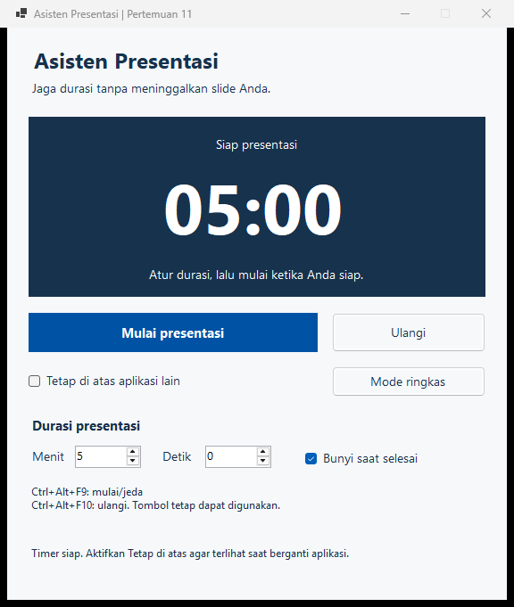
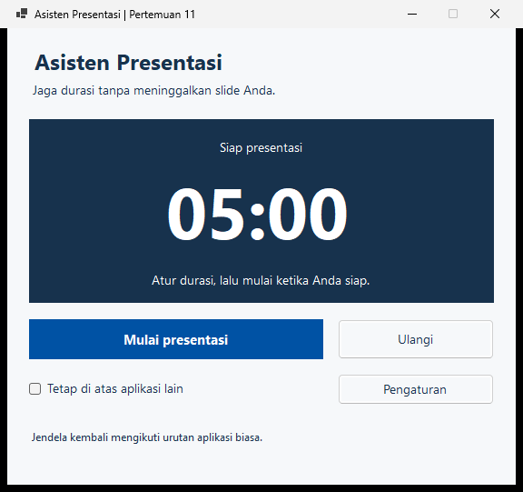
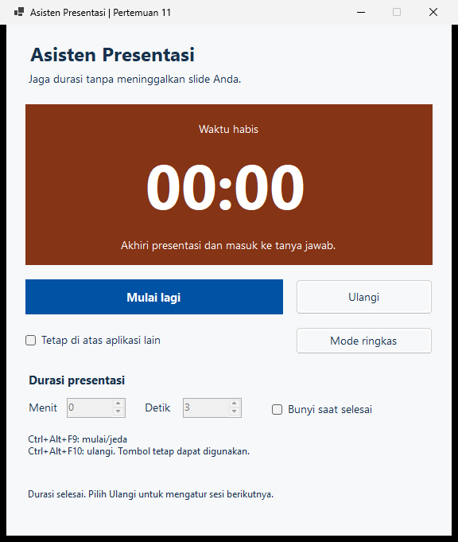
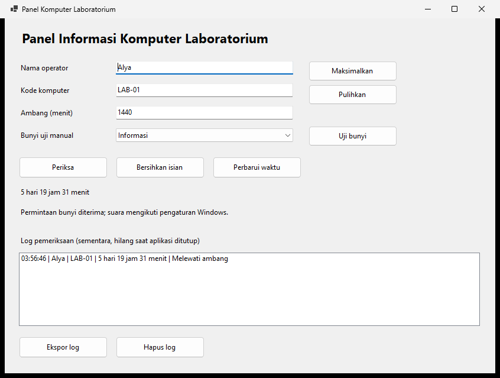

# Pertemuan 11: Windows API melalui Asisten Presentasi

Materi lengkap Pertemuan 11, mengikuti deck 35 slide yang mendahulukan teori dan penjelasan sebelum praktik.

- [Panduan praktik](pertemuan-11/praktik.md)
- [Penjelasan tiap bagian kode praktik](pertemuan-11/penjelasan-kode-praktik.md)
- [PDF penjelasan kode praktik](pertemuan-11/penjelasan-kode-praktik.pdf)
- [Source Asisten Presentasi](pertemuan-11/kode/DemoWindowsApi/DemoWindowsApi.sln)
- [Tugas praktik](pertemuan-11/tugas.md)
- [Deck Canva](https://www.canva.com/d/YzpF9MafN9PGJ1y)

Pemrograman Visual, TIF 3 031. VB.NET Windows Forms, .NET 10. Contoh memerlukan Windows; tidak memakai database atau paket tambahan.

## Landasan teori sebelum studi kasus

Slide 3 sampai 19 membahas konsep dasar, slide 20 sampai 24 menghubungkannya dengan deklarasi dan mekanisme pemanggilan, lalu slide 25 sampai 31 menerapkannya pada Asisten Presentasi. Praktik digunakan untuk membuktikan konsep yang telah dipahami.

### Aplikasi, sistem operasi, dan API

Aplikasi menetapkan aturan pekerjaan, misalnya kapan waktu presentasi berakhir. Windows menyediakan layanan untuk mengelola sumber daya desktop, input, dan kemampuan sistem. API, Application Programming Interface, menjelaskan cara perangkat lunak menggunakan kemampuan perangkat lunak lain: tindakan yang tersedia, input yang diperlukan, dan hasil yang diberikan.

Antarmuka berbeda dari implementasi. Mengetahui fungsi untuk meminta bunyi tidak mengharuskan kita menulis ulang cara Windows menghasilkan bunyi tersebut. Aplikasi tetap menentukan kapan bunyi diperlukan dan bagaimana hasil permintaannya ditangani.

Windows API mencakup berbagai bidang, seperti antarmuka desktop, input, pengelolaan proses, berkas, dan informasi sistem. Istilah Win32 tidak berarti penggunaannya hanya untuk aplikasi 32 bit; Windows API juga mendukung aplikasi 64 bit. [Indeks Windows API](https://learn.microsoft.com/en-us/windows/win32/apiindex/windows-api-list).

### DLL, kode native, dan P/Invoke

DLL, Dynamic-Link Library, adalah pustaka yang dapat dimuat dan digunakan program. Pada contoh ini, fungsi yang dituju diekspor dari DLL native Windows. Deklarasi VB.NET memberi keterangan pemanggilan; implementasi Windows tidak disalin menjadi prosedur VB.NET. [Dynamic-link libraries](https://learn.microsoft.com/en-us/windows/win32/dlls/about-dynamic-link-libraries).

Kode VB.NET dalam contoh berjalan di lingkungan .NET, sedangkan fungsi Windows yang dipanggil berasal dari pustaka native. P/Invoke memungkinkan pemanggilan melintasi batas tersebut. Runtime memakai deklarasi untuk menghubungkan metode managed dengan fungsi native yang dituju. [P/Invoke](https://learn.microsoft.com/en-us/dotnet/standard/native-interop/pinvoke).

Marshalling menyesuaikan representasi data ketika melewati batas managed dan native. Sebuah tipe yang tampak serupa belum tentu mempunyai representasi sama di kedua sisi. Karena itu, tipe dan aturan pemetaan harus mengikuti kontrak fungsi. [Type marshalling](https://learn.microsoft.com/en-us/dotnet/standard/native-interop/type-marshalling).

### Kontrak, parameter, hasil, dan handle

Kontrak fungsi mencakup nama, pustaka, parameter, tipe hasil, dan ketentuan pemakaian. Parameter memberi input; nilai kembali menyediakan data atau status sesudah fungsi dipanggil. Tidak semua fungsi memerlukan input, dan tidak semua hasil merupakan penanda sukses.

Handle adalah pengenal sumber daya yang dipakai sistem. HWND merujuk jendela, sedangkan objek Form adalah representasi antarmuka pada sisi VB.NET. `Me.Handle` menyediakan pengenal native milik form untuk fungsi yang memerlukan sasaran jendela. Pemetaan `IntPtr` menjaga kesesuaian ukuran pointer proses.

Deklarasi baru menjelaskan hubungan ke fungsi luar; pemanggilanlah yang menjalankannya. VB.NET mendukung Declare dan DllImport untuk keperluan ini. Fasilitas .NET tetap menjadi pilihan awal bila kebutuhan sudah terpenuhi. [Pemanggilan Windows API dari Visual Basic](https://learn.microsoft.com/en-us/dotnet/visual-basic/programming-guide/com-interop/walkthrough-calling-windows-apis).

### Pesan dan siklus pemakaian

Event WinForms menyederhanakan penanganan interaksi, sedangkan Windows juga mengirim pesan kepada jendela. Pada integrasi tertentu, aplikasi mengenali jenis pesan dan mengarahkannya ke prosedur yang sesuai. Contoh shortcut global memperlihatkan mekanisme ini tanpa mengharuskan seluruh kode antarmuka ditulis sebagai penanganan pesan native.

Pendaftaran layanan mempunyai siklus: minta fasilitas, gunakan selama diperlukan, lalu lepaskan sesuai kontraknya. Penjelasan RegisterHotKey, WM_HOTKEY, serta UnregisterHotKey pada bagian studi kasus menerapkan prinsip tersebut. Deklarasi, pemanggilan, pemeriksaan hasil, dan cleanup adalah satu rangkaian tanggung jawab.

## 1. Masalah: mengatur waktu sambil menampilkan slide

Saat presentasi, pembicara perlu melihat sisa waktu tanpa terus berpindah aplikasi. Kita membuat **Asisten Presentasi**: atur durasi, mulai hitung mundur, pertahankan timer di atas jendela biasa, lalu gunakan shortcut untuk menjeda atau melanjutkan sambil tetap berada di aplikasi slide. Saat waktu habis, aplikasi memberi penanda visual dan bunyi opsional.



Alur pemakaiannya:

1. Tentukan menit dan detik. Nilai awal 5 menit.
2. Pilih **Mulai presentasi**.
3. Aktifkan **Tetap di atas aplikasi lain** dan **Mode ringkas** bila dibutuhkan.
4. Berpindah ke slide. Tekan **Ctrl+Alt+F9** untuk jeda/lanjut dan **Ctrl+Alt+F10** untuk mengulangi dari durasi awal.
5. Ketika mencapai nol, tampilkan **Waktu habis**. Bunyi mengikuti pilihan pengguna dan pengaturan audio Windows.



Mode ringkas menyembunyikan pengaturan; tombol mulai/jeda, ulangi, dan pilihan posisi jendela tetap tersedia. Ringkas adalah perubahan tata letak WinForms, bukan fungsi Windows API baru.

## 2. Bagian VB.NET dan bagian Windows API

Event, Module, Function, If, serta pembagian bulat sudah dipakai pada pertemuan sebelumnya. Sekarang sebagian Function menunjuk implementasi di DLL Windows melalui P/Invoke.

| Kebutuhan | Pelaksana | Alasan |
|---|---|---|
| Menampilkan angka, tombol, dan isian | Kontrol WinForms | Antarmuka aplikasi |
| Menyimpan status berjalan/jeda | Variabel dan prosedur VB.NET | Aturan aplikasi |
| Memperbarui tampilan berkala | Windows Forms Timer | Memicu event Tick |
| Mengukur selang waktu | GetTickCount64, kernel32.dll | Membaca pencacah milidetik native |
| Menempatkan timer di atas jendela biasa | SetWindowPos, user32.dll | Mengubah urutan jendela |
| Shortcut saat aplikasi lain aktif | RegisterHotKey dan UnregisterHotKey, user32.dll | Mendaftarkan dan melepas shortcut global |
| Bunyi ketika selesai | MessageBeep, user32.dll | Meminta bunyi sistem |

DLL berisi implementasi native. Deklarasi VB.NET menyatakan kontraknya; runtime .NET menghubungkan pemanggilan melalui P/Invoke. Nama Win32 tetap digunakan pada proses 64 bit.

## 3. Membaca kontrak fungsi

Periksa nama fungsi, DLL, tipe parameter, serta makna hasil pada dokumentasi Microsoft. Kesamaan nama tipe tidak menjamin ukuran yang sama.

| Tipe native | VB.NET dalam contoh | Penjelasan |
|---|---|---|
| HWND | IntPtr | Handle jendela, mengikuti ukuran pointer proses |
| int | Integer | Bilangan 32 bit |
| UINT | UInteger | Bilangan 32 bit tanpa tanda |
| ULONGLONG | ULong | Bilangan 64 bit tanpa tanda |
| BOOL | Boolean pada deklarasi P/Invoke ini | Hasil logis dengan marshalling native |

`Me.Handle` adalah pengenal jendela native milik form. Jangan menyalin deklarasi VB6 tanpa menyesuaikan tipe: Long VB.NET berukuran 64 bit, sedangkan LONG Win32 berukuran 32 bit.

## 4. Declare untuk membaca waktu

```vb
Public Declare Function GetTickCount64 Lib "kernel32.dll" () As ULong
```

`Declare` mengenalkan fungsi eksternal. `Lib` menunjuk DLL. Hasilnya milidetik sejak sistem dimulai. Kita memakai **selisih dua pembacaan**, sehingga aplikasi menampilkan sisa durasi presentasi, bukan uptime komputer.

```vb
mulaiTick = GetTickCount64()
' Pada pembaruan berikutnya:
Dim elapsed As ULong = terpakai + GetTickCount64() - mulaiTick
Dim sisa As ULong = HitungSisa(durasi, elapsed)
```

`terpakai` menyimpan waktu dari bagian sesi sebelum jeda. `mulaiTick` mencatat awal bagian sesi yang sedang berjalan. Saat dilanjutkan, ambil titik awal baru agar waktu selama jeda tidak ikut terhitung.

Timer WinForms diatur 100 ms untuk menyegarkan tampilan. Jangan mengurangi durasi sebesar 100 ms setiap Tick: event bisa terlambat ketika UI sibuk. Selisih pencacah tetap menjadi dasar perhitungan.

GetTickCount64 bukan pencacah presisi tinggi; resolusinya biasanya 10 sampai 16 ms. Waktu sleep/hibernasi ikut berlalu pada pencacah ini. Untuk presentasi, sesi berjalan tetap menghabiskan durasi ketika komputer tidur. [Dokumentasi GetTickCount64](https://learn.microsoft.com/en-us/windows/win32/api/sysinfoapi/nf-sysinfoapi-gettickcount64), [Windows time](https://learn.microsoft.com/en-us/windows/win32/sysinfo/windows-time).

## 5. Menghitung sisa dan menampilkan menit:detik

`ULong` tidak mempunyai nilai negatif. Periksa batas sebelum pengurangan agar tidak terjadi underflow ketika waktu terpakai melebihi durasi:

```vb
Public Function HitungSisa(durasi As ULong, terpakai As ULong) As ULong
    If terpakai >= durasi Then Return 0UL
    Return durasi - terpakai
End Function
```

Format tampilan menggunakan pembagian bulat dan Mod. Pecahan detik dibulatkan ke atas: sisa 1 ms masih tampil 00:01, lalu menjadi 00:00 saat benar-benar habis. Fungsi lengkap ada pada lampiran Module.

## 6. Mulai, jeda, lanjut, dan ulangi

| Keadaan | Tombol utama | Pengaturan durasi | Perhitungan |
|---|---|---|---|
| Siap | Mulai presentasi | Dapat diubah | Menampilkan durasi pilihan |
| Berjalan | Jeda | Dikunci | Selisih pencacah dihitung |
| Dijeda | Lanjutkan | Dikunci | Waktu terpakai disimpan |
| Selesai | Mulai lagi | Dikunci sampai Ulangi | Nol, Timer berhenti |

Ulangi menghentikan sesi, membuka pengaturan, dan mengembalikan durasi awal. Durasi 00:00 ditolak dengan pesan; pengguna tetap dapat memperbaiki isian. Penanda selesai memakai teks dan perubahan warna, sehingga tidak bergantung pada bunyi atau warna saja.



## 7. DllImport untuk SetWindowPos

```vb
<DllImport("user32.dll", ExactSpelling:=True, SetLastError:=True)>
Public Function SetWindowPos(hWnd As IntPtr, hWndInsertAfter As IntPtr,
    x As Integer, y As Integer, cx As Integer, cy As Integer,
    uFlags As UInteger) As Boolean
End Function
```

Tambahkan `Imports System.Runtime.InteropServices`. DllImport adalah cara deklarasi lain; keduanya memanggil fungsi native. Gunakan satu deklarasi untuk satu pemanggilan.

`HWND_TOPMOST` menempatkan jendela di kelompok teratas; `HWND_NOTOPMOST` mengembalikannya ke kelompok biasa. Gabungkan `SWP_NOMOVE`, `SWP_NOSIZE`, dan `SWP_NOACTIVATE` agar posisi, ukuran, dan fokus tidak sengaja diubah. Hasil False menandakan kegagalan; baca `Marshal.GetLastPInvokeError()` segera setelahnya. [Dokumentasi SetWindowPos](https://learn.microsoft.com/en-us/windows/win32/api/winuser/nf-winuser-setwindowpos).

Jendela teratas berlaku terhadap jendela biasa. Jangan menjanjikan tampil di atas secure desktop atau semua aplikasi fullscreen eksklusif. WinForms juga menyediakan `TopMost` untuk kebutuhan biasa; contoh ini sengaja memperlihatkan kontrak native di balik pengaturan jendela.

## 8. Shortcut global: manfaat yang terlihat di luar form

Mnemonic `Alt+huruf` pada tombol berlaku ketika form menerima interaksi. Shortcut global didaftarkan kepada Windows, sehingga timer dapat dikendalikan saat aplikasi slide memiliki fokus.

```vb
Dim modifier As UInteger = MOD_CONTROL Or MOD_ALT Or MOD_NOREPEAT
shortcutMulai = RegisterHotKey(Me.Handle, ID_MULAI, modifier, VK_F9)
```

ID membedakan tindakan. `MOD_NOREPEAT` mencegah tombol yang ditahan memicu tindakan berulang. Pendaftaran bisa gagal, misalnya karena kombinasi sudah dipakai aplikasi lain; form menampilkan shortcut yang tidak tersedia dan tombol tetap berfungsi. [Dokumentasi RegisterHotKey](https://learn.microsoft.com/en-us/windows/win32/api/winuser/nf-winuser-registerhotkey).

Windows mengirim pesan `WM_HOTKEY` kepada handle yang didaftarkan. `WndProc` adalah pintu masuk pesan pada Form. Bagian ini merupakan pengenalan pesan native, bukan pengganti semua event WinForms. `Overrides` menyesuaikan metode yang diwarisi dari Form, `ByRef` mempertahankan referensi Message, `m.Msg` menentukan jenis pesan, dan `m.WParam` memuat ID shortcut. Pesan lain tetap diteruskan melalui `MyBase.WndProc(m)`. [Dokumentasi WM_HOTKEY](https://learn.microsoft.com/en-us/windows/win32/inputdev/wm-hotkey).

Saat handle dihancurkan, lepaskan shortcut yang berhasil didaftarkan dengan `UnregisterHotKey`. Saat handle baru dibuat, daftarkan lagi. Jangan mengakses `Me.Handle` untuk cleanup setelah handle dihancurkan; simpan handle pendaftaran. [Dokumentasi UnregisterHotKey](https://learn.microsoft.com/en-us/windows/win32/api/winuser/nf-winuser-unregisterhotkey).

## 9. Bunyi sebagai bagian dari alur selesai

MessageBeep dipanggil satu kali ketika sesi berakhir, jika **Bunyi saat selesai** dipilih. Timer dihentikan terlebih dahulu agar bunyi tidak diminta pada setiap Tick. Hasil True berarti permintaan berhasil, bukan bukti bahwa pengguna mendengar suara. Volume dan skema suara Windows tetap berpengaruh. [Dokumentasi MessageBeep](https://learn.microsoft.com/en-us/windows/win32/api/winuser/nf-winuser-messagebeep).

## 10. Memindahkan konsep ke tugas laboratorium

Tugas menggunakan kasus berbeda: **Panel Komputer Laboratorium**. GetTickCount64 ditampilkan sebagai hari/jam/menit untuk inspeksi, bukan sebagai hitung mundur. MessageBeep mengikuti hasil pemeriksaan.

Tugas juga menggunakan ShowWindow pada jendela sendiri:

```vb
Public Declare Function ShowWindow Lib "user32.dll" (
    hWnd As IntPtr, nCmdShow As Integer) As Boolean
Public Const SW_MAXIMIZE As Integer = 3
Public Const SW_RESTORE As Integer = 9
```

Panggil `ShowWindow(Me.Handle, SW_MAXIMIZE)` atau `ShowWindow(Me.Handle, SW_RESTORE)`. Hasilnya menyatakan visibilitas sebelumnya, bukan indikator sukses umum. False tidak otomatis berarti gagal. Ini berbeda dari SetWindowPos. [Dokumentasi ShowWindow](https://learn.microsoft.com/en-us/windows/win32/api/winuser/nf-winuser-showwindow).

Tugas tidak mewajibkan shortcut global. Mahasiswa menerapkan deklarasi, pemetaan tipe, pengolahan waktu, validasi P7, dan pemeriksaan hasil API pada domain lain.

## 11. Kesalahan umum dan pilihan .NET

- Menganggap semua Boolean native bermakna sama.
- Memakai Integer untuk HWND pada proses 64 bit.
- Mengurangi waktu berdasarkan jumlah Tick, sehingga keterlambatan UI ikut menambah durasi.
- Membaca 1.000 milidetik sebagai 1.000 detik.
- Mengurangi dua ULong tanpa memeriksa batas.
- Melupakan cleanup shortcut atau mengklaim shortcut aktif ketika pendaftarannya gagal.
- Menganggap bunyi senyap pasti berarti pemanggilan API gagal.

Pilih fasilitas .NET ketika sudah memenuhi kebutuhan: `Form.TopMost`, `System.Media.SystemSounds`, atau `Stopwatch` untuk mengukur durasi. P/Invoke diperlukan ketika kontrak native tertentu memang ingin diakses. Menggunakan API secara langsung untuk belajar tidak berarti semua aplikasi harus menghindari fasilitas .NET.

## Lampiran kode yang sama dengan proyek

### ModWindowsApi.vb

<!-- KODE: pertemuan-11/kode/DemoWindowsApi/ModWindowsApi.vb -->
```vb
Option Strict On
Imports System.Runtime.InteropServices

Public Module ModWindowsApi
    Public Const MB_ICONINFORMATION As UInteger = &H40UI
    Public Const WM_HOTKEY As Integer = &H312
    Public Const ID_MULAI As Integer = 1
    Public Const ID_ULANGI As Integer = 2
    Public Const MOD_CONTROL As UInteger = &H2UI
    Public Const MOD_ALT As UInteger = &H1UI
    Public Const MOD_NOREPEAT As UInteger = &H4000UI
    Public Const VK_F9 As UInteger = &H78UI
    Public Const VK_F10 As UInteger = &H79UI
    Public Const SWP_NOSIZE As UInteger = &H1UI
    Public Const SWP_NOMOVE As UInteger = &H2UI
    Public Const SWP_NOACTIVATE As UInteger = &H10UI
    Public ReadOnly HWND_TOPMOST As New IntPtr(-1)
    Public ReadOnly HWND_NOTOPMOST As New IntPtr(-2)

    Public Declare Function GetTickCount64 Lib "kernel32.dll" () As ULong

    Public Declare Function MessageBeep Lib "user32.dll" (
        uType As UInteger) As Boolean

    <DllImport("user32.dll", ExactSpelling:=True, SetLastError:=True)>
    Public Function SetWindowPos(hWnd As IntPtr, hWndInsertAfter As IntPtr,
        x As Integer, y As Integer, cx As Integer, cy As Integer,
        uFlags As UInteger) As Boolean
    End Function

    <DllImport("user32.dll", ExactSpelling:=True, SetLastError:=True)>
    Public Function RegisterHotKey(hWnd As IntPtr, id As Integer,
        fsModifiers As UInteger, vk As UInteger) As Boolean
    End Function

    <DllImport("user32.dll", ExactSpelling:=True, SetLastError:=True)>
    Public Function UnregisterHotKey(hWnd As IntPtr, id As Integer) As Boolean
    End Function

    Public Function HitungSisa(durasi As ULong, terpakai As ULong) As ULong
        If terpakai >= durasi Then Return 0UL
        Return durasi - terpakai
    End Function

    Public Function FormatSisa(milidetik As ULong) As String
        Dim detik As ULong = milidetik \ 1000UL
        If milidetik Mod 1000UL > 0UL Then detik += 1UL
        Return $"{detik \ 60UL:00}:{detik Mod 60UL:00}"
    End Function
End Module
```
<!-- /KODE -->

### FrmDemoApi.vb

Semua kontrol berada di `FrmDemoApi.Designer.vb`. File berikut hanya berisi state, event, dan pemanggilan native. [Panduan membuat form](pertemuan-11/praktik.md).

<!-- KODE: pertemuan-11/kode/DemoWindowsApi/FrmDemoApi.vb -->
```vb
Option Strict On
Imports System.Runtime.InteropServices

Partial Class FrmDemoApi
    Private durasi As ULong
    Private terpakai As ULong
    Private mulaiTick As ULong
    Private berjalan As Boolean
    Private selesai As Boolean
    Private ringkas As Boolean
    Private mengubahPin As Boolean
    Private handleShortcut As IntPtr
    Private shortcutMulai As Boolean
    Private shortcutUlangi As Boolean
    Private ukuranLengkap As Size

    Private Sub FrmDemoApi_Load(sender As Object, e As EventArgs) Handles MyBase.Load
        ukuranLengkap = Me.ClientSize
        UlangiTimer()
    End Sub

    Private Sub FrmDemoApi_HandleCreated(sender As Object, e As EventArgs) Handles MyBase.HandleCreated
        handleShortcut = Me.Handle
        Dim modifier As UInteger = MOD_CONTROL Or MOD_ALT Or MOD_NOREPEAT
        shortcutMulai = RegisterHotKey(handleShortcut, ID_MULAI, modifier, VK_F9)
        shortcutUlangi = RegisterHotKey(handleShortcut, ID_ULANGI, modifier, VK_F10)
        Dim mulai As String = If(shortcutMulai, "Ctrl+Alt+F9: mulai/jeda", "Shortcut mulai tidak tersedia")
        Dim ulang As String = If(shortcutUlangi, "Ctrl+Alt+F10: ulangi", "Shortcut ulangi tidak tersedia")
        lblShortcut.Text = mulai & vbCrLf & ulang & ". Tombol tetap dapat digunakan."
        If chkTeratas.Checked Then chkTeratas_CheckedChanged(Me, EventArgs.Empty)
    End Sub

    Private Sub FrmDemoApi_HandleDestroyed(sender As Object, e As EventArgs) Handles MyBase.HandleDestroyed
        If shortcutMulai Then UnregisterHotKey(handleShortcut, ID_MULAI)
        If shortcutUlangi Then UnregisterHotKey(handleShortcut, ID_ULANGI)
        shortcutMulai = False
        shortcutUlangi = False
        handleShortcut = IntPtr.Zero
    End Sub

    Protected Overrides Sub WndProc(ByRef m As Message)
        If m.Msg = WM_HOTKEY Then
            If m.WParam.ToInt32() = ID_MULAI AndAlso shortcutMulai Then MulaiAtauJeda()
            If m.WParam.ToInt32() = ID_ULANGI AndAlso shortcutUlangi Then UlangiTimer()
        End If
        MyBase.WndProc(m)
    End Sub

    Private Sub btnMulai_Click(sender As Object, e As EventArgs) Handles btnMulai.Click
        MulaiAtauJeda()
    End Sub

    Private Sub btnUlangi_Click(sender As Object, e As EventArgs) Handles btnUlangi.Click
        UlangiTimer()
    End Sub

    Private Sub MulaiAtauJeda()
        If berjalan Then
            PerbaruiHitungan()
            If selesai Then Return
            terpakai += GetTickCount64() - mulaiTick
            berjalan = False
            tmrHitung.Stop()
            btnMulai.Text = "&Lanjutkan"
            lblTahap.Text = "Dijeda"
            lblKeterangan.Text = "Waktu berhenti sampai Anda melanjutkan."
            lblStatus.Text = "Timer dijeda. Durasi dapat diubah setelah memilih Ulangi."
            Return
        End If
        If selesai Then UlangiTimer()
        If durasi = 0UL Then
            lblStatus.Text = "Isi durasi lebih dari 0 detik sebelum mulai."
            nudDetik.Focus()
            Return
        End If
        mulaiTick = GetTickCount64()
        berjalan = True
        nudMenit.Enabled = False
        nudDetik.Enabled = False
        btnMulai.Text = "&Jeda"
        lblTahap.Text = "Presentasi berlangsung"
        lblKeterangan.Text = "Sisa waktu presentasi Anda"
        lblStatus.Text = "Timer berjalan. Anda dapat berpindah ke aplikasi slide."
        tmrHitung.Start()
    End Sub

    Private Sub UlangiTimer()
        tmrHitung.Stop()
        berjalan = False
        selesai = False
        terpakai = 0UL
        durasi = CULng(nudMenit.Value * 60D + nudDetik.Value) * 1000UL
        nudMenit.Enabled = True
        nudDetik.Enabled = True
        btnMulai.Text = "&Mulai presentasi"
        lblTahap.Text = "Siap presentasi"
        lblSisa.Text = FormatSisa(durasi)
        lblKeterangan.Text = "Atur durasi, lalu mulai ketika Anda siap."
        pnlTimer.BackColor = Color.FromArgb(23, 50, 77)
        lblStatus.Text = "Timer siap. Aktifkan Tetap di atas agar terlihat saat berganti aplikasi."
    End Sub

    Private Sub Durasi_ValueChanged(sender As Object, e As EventArgs) Handles nudMenit.ValueChanged, nudDetik.ValueChanged
        If Not berjalan AndAlso nudMenit.Enabled Then UlangiTimer()
    End Sub

    Private Sub tmrHitung_Tick(sender As Object, e As EventArgs) Handles tmrHitung.Tick
        PerbaruiHitungan()
    End Sub

    Private Sub PerbaruiHitungan()
        If Not berjalan Then Return
        Dim elapsed As ULong = terpakai + GetTickCount64() - mulaiTick
        Dim sisa As ULong = HitungSisa(durasi, elapsed)
        lblSisa.Text = FormatSisa(sisa)
        If sisa = 0UL Then WaktuHabis()
    End Sub

    Private Sub WaktuHabis()
        tmrHitung.Stop()
        berjalan = False
        selesai = True
        lblTahap.Text = "Waktu habis"
        lblKeterangan.Text = "Akhiri presentasi dan masuk ke tanya jawab."
        pnlTimer.BackColor = Color.FromArgb(133, 52, 21)
        btnMulai.Text = "&Mulai lagi"
        lblStatus.Text = "Durasi selesai. Pilih Ulangi untuk mengatur sesi berikutnya."
        If chkBunyi.Checked Then
            If Not MessageBeep(MB_ICONINFORMATION) Then
                lblStatus.Text = "Waktu habis. Bunyi tidak dapat diputar; penanda visual tetap aktif."
            End If
        End If
    End Sub

    Private Sub chkTeratas_CheckedChanged(sender As Object, e As EventArgs) Handles chkTeratas.CheckedChanged
        If mengubahPin Then Return
        Dim posisi As IntPtr = If(chkTeratas.Checked, HWND_TOPMOST, HWND_NOTOPMOST)
        Dim flags As UInteger = SWP_NOMOVE Or SWP_NOSIZE Or SWP_NOACTIVATE
        If SetWindowPos(Me.Handle, posisi, 0, 0, 0, 0, flags) Then
            lblStatus.Text = If(chkTeratas.Checked, "Timer tetap di atas jendela biasa. Gunakan Mode ringkas saat presentasi.", "Jendela kembali mengikuti urutan aplikasi biasa.")
        Else
            Dim kode As Integer = Marshal.GetLastPInvokeError()
            mengubahPin = True
            chkTeratas.Checked = Not chkTeratas.Checked
            mengubahPin = False
            lblStatus.Text = $"Posisi jendela tidak dapat diubah. Kode Windows: {kode}."
        End If
    End Sub

    Private Sub btnRingkas_Click(sender As Object, e As EventArgs) Handles btnRingkas.Click
        If Not ringkas Then ukuranLengkap = Me.ClientSize
        ringkas = Not ringkas
        pnlPengaturan.Visible = Not ringkas
        btnRingkas.Text = If(ringkas, "&Pengaturan", "Mode &ringkas")
        Dim bingkai As New Size(Me.Width - Me.ClientSize.Width, Me.Height - Me.ClientSize.Height)
        Dim tinggi As Integer = If(ringkas, pnlPengaturan.Top + lblStatus.Height + 24, ukuranLengkap.Height)
        Me.MinimumSize = New Size(ukuranLengkap.Width + bingkai.Width, tinggi + bingkai.Height)
        Me.ClientSize = New Size(ukuranLengkap.Width, tinggi)
    End Sub
End Class
```
<!-- /KODE -->

## Tugas praktik

<!-- TUGAS: pertemuan-11/tugas.md -->
### Tugas Pertemuan 11: Panel Informasi Komputer Laboratorium

Mata kuliah Pemrograman Visual (TIF 3 031). Tugas individu.

#### Kasus

Petugas laboratorium mencatat komputer yang diperiksa dan lama Windows telah berjalan. Petugas menentukan ambang dalam menit untuk membantu menentukan komputer mana yang perlu ditinjau. Ambang ini hanya aturan latihan, bukan ukuran kesehatan komputer yang sebenarnya.

Buat aplikasi **PanelKomputerLab**, Windows Forms VB.NET .NET 10, tanpa database. Log tersimpan sementara selama aplikasi terbuka.

#### Kontrol

| Kontrol | Nama | Kegunaan |
|---|---|---|
| TextBox | txtOperator | Nama petugas |
| TextBox | txtKode | Kode komputer, misalnya LAB-01 |
| TextBox | txtAmbang | Ambang dalam menit |
| ComboBox | cboBunyi | Informasi/Peringatan untuk uji manual, DropDownList |
| Button | btnPeriksa | Memvalidasi, memeriksa waktu sistem, dan menambah log |
| Button | btnBersihkan | Mengosongkan isian tanpa menghapus log |
| Button | btnPerbarui | Membaca ulang waktu sistem |
| Button | btnUjiBunyi | Menguji bunyi dari cboBunyi |
| Button | btnMaksimalkan | Memaksimalkan jendela sendiri |
| Button | btnPulihkan | Memulihkan jendela sendiri |
| Label | lblWaktuSistem | Hari, jam, dan menit sejak sistem dimulai |
| Label | lblStatus | Hasil pemeriksaan/tindakan |
| ListBox | lstLog | Daftar pemeriksaan |
| ErrorProvider | errInput | Penanda input tidak valid |

Tambahkan judul dan Label untuk semua isian. Gunakan nama seperti `lblOperator`, `lblKode`, `lblAmbang`, `lblBunyi`, dan `lblLog`.

#### Fitur wajib

1. **Struktur.** Deklarasi native dan konstanta ada di Module. Form mendukung Designer. Gunakan `IntPtr` untuk HWND dan `ULong` untuk hasil GetTickCount64.
2. **Validasi.** `Function ValidasiInput() As Boolean` menghapus error lama lalu memeriksa seluruh isian:
    - nama operator minimal 3 karakter setelah Trim;
    - kode tepat `LAB-` diikuti dua digit ASCII, misalnya LAB-01;
    - ambang berupa bilangan bulat 1 sampai 1440, diperiksa dengan Integer.TryParse;
    - jenis bunyi manual telah dipilih.
3. **Perbarui.** Baca GetTickCount64 saat aplikasi dibuka dan saat btnPerbarui diklik. Tampilkan sebagai hari/jam/menit. Perbarui tidak menambah log.
4. **Periksa.** Validasi dahulu. Jika valid, baca waktu terbaru dan tentukan status:
    - waktu sistem lebih kecil dari ambang: **Normal**;
    - waktu sistem sama dengan atau lebih besar dari ambang: **Melewati ambang**.

    Bandingkan milidetik dengan `CULng(ambang) * 60000UL`. Jangan hanya membandingkan komponen menit yang tersisa setelah Mod.
5. **Notifikasi.** Pemeriksaan Normal memanggil MessageBeep Informasi; Melewati ambang memakai Peringatan. cboBunyi hanya mengatur tombol Uji Bunyi manual. Jika permintaan bunyi gagal, tampilkan pesan tanpa menghilangkan hasil dan log pemeriksaan. Suara yang tidak terdengar tidak boleh langsung dianggap kegagalan API.
6. **Log.** Setiap pemeriksaan valid menambah satu item: waktu pemeriksaan, operator, kode komputer, lama sistem berjalan, dan status. Input tidak valid tidak menambah log atau memanggil bunyi pemeriksaan.
7. **Jendela.** Maksimalkan dan Pulihkan menggunakan ShowWindow pada `Me.Handle`. Jangan memperlakukan hasil False sebagai kegagalan umum.
8. **Bersihkan.** Kosongkan isian teks dan ErrorProvider, kembalikan pilihan bunyi ke Informasi, lalu fokus ke operator. Log tetap tersedia.

#### Tantangan tambahan

1. Ekspor seluruh log ke berkas teks dengan SaveFileDialog dan penanganan IOException/UnauthorizedAccessException. Gunakan Finally untuk menutup penulis berkas, seperti P7.
2. Hapus seluruh log setelah konfirmasi. Memilih Tidak mempertahankan log.

#### Pengujian

| Data/tindakan | Hasil |
|---|---|
| Operator kosong, LAB-1, ambang abc | Semua kesalahan ditandai; log tidak bertambah |
| Operator Alya, LAB-01, ambang 0 | Ambang ditolak |
| Operator Alya, LAB-01, ambang 1441 | Ambang ditolak |
| Ambang 1 dan 1440 | Keduanya diterima sebagai batas input |
| Waktu 59.999 ms, ambang 1 | Normal |
| Waktu 60.000 ms, ambang 1 | Melewati ambang |
| Waktu 60.001 ms, ambang 1 | Melewati ambang |
| Perbarui | Waktu dibaca ulang tanpa log baru |
| Bersihkan sesudah pemeriksaan | Isian kosong; log tetap ada |

Tiga nilai waktu pada tabel adalah data uji fungsi penentuan status, bukan nilai palsu untuk ditampilkan sebagai pembacaan komputer. Saat aplikasi berjalan normal, tetap gunakan GetTickCount64.

#### Contoh tampilan



Tata letak boleh berbeda. Contoh kunci memuat fitur ekspor dan hapus log yang bersifat opsional.

#### Ketentuan dan pengumpulan

1. Windows Forms VB.NET, .NET 10, `Option Strict On`.
2. Nama kontrol sesuai tabel dan form dapat dibuka di Designer Visual Studio.
3. Kumpulkan folder source code proyek beserta screenshot hasil pemeriksaan valid dan error validasi. Sertakan `.sln`, `.vbproj`, `.vb`, `.Designer.vb`, dan `.resx` jika ada. Folder bin/obj tidak diperlukan.
4. Tambahkan catatan singkat hasil pengujian, termasuk batas ambang dan keadaan suara Windows.
5. Unggah ke LMS **kelas.usu.ac.id**. Tenggat mengikuti pengumuman pengajar di LMS.

#### Penilaian

| Aspek | Bobot |
|---|---:|
| Fungsionalitas sesuai spesifikasi | 25% |
| Struktur, penamaan, dan kualitas kode | 20% |
| Penerapan konsep VB dan Windows API | 20% |
| Interaksi komponen visual dan log | 20% |
| Validasi dan penanganan error | 10% |
| Ketepatan waktu dan dokumentasi | 5% |

Mengacu pada Rubrik Penilaian Tugas Praktik Coding dalam RPS.
<!-- /TUGAS -->
