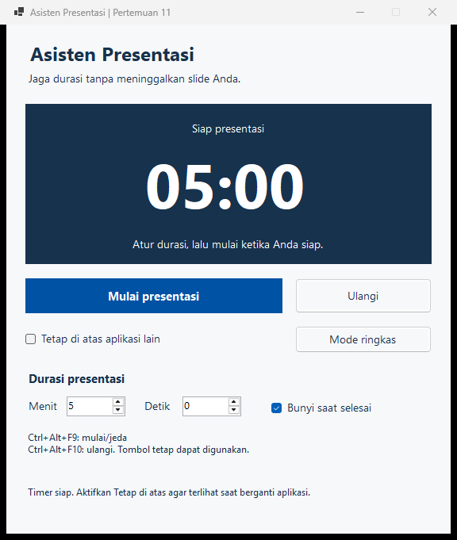
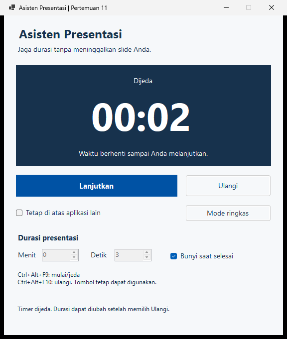
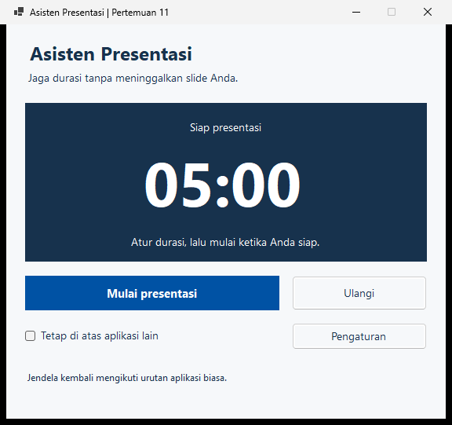

# Praktik Pertemuan 11: Asisten Presentasi

Buat timer yang dapat menemani aplikasi slide. Contoh lengkap tersedia dalam [solution DemoWindowsApi](kode/DemoWindowsApi/DemoWindowsApi.sln); nama folder dan kelas dipertahankan agar rujukan proyek tetap bekerja. Nama aplikasi yang tampil adalah **Asisten Presentasi**.

## 1. Jalankan contoh dahulu

Dari root repository:

```powershell
dotnet run --project pertemuan-11/kode/DemoWindowsApi/DemoWindowsApi.vbproj
```

Atur 0 menit 5 detik untuk uji singkat. Klik Mulai, coba Jeda dan Lanjutkan, lalu tunggu Waktu habis. Ulangi membuka pengaturan kembali. Aktifkan Tetap di atas dan Mode ringkas, lalu pindah ke jendela biasa lain dan uji Ctrl+Alt+F9 serta Ctrl+Alt+F10.



## 2. Buat proyek dan pisahkan tampilan dari logika

1. Buat proyek **Windows Forms App**, VB.NET, .NET 10, bernama `DemoWindowsApi`.
2. Ubah Form menjadi `FrmDemoApi`. Aktifkan Option Strict On.
3. Tambahkan Module `ModWindowsApi`.
4. Susun kontrol lewat Designer. Semua kontrol tetap dideklarasikan pada `FrmDemoApi.Designer.vb`, bukan dibuat saat Load.
5. Hubungkan event dengan `Handles` dalam `FrmDemoApi.vb`.

| Properti form | Nilai |
|---|---|
| Text | Asisten Presentasi, Pertemuan 11 |
| ClientSize | 560;642 |
| MinimumSize | 576;681 pada DPI dasar |
| Font | Segoe UI, 10 pt |
| AutoScaleMode | Font |
| StartPosition | CenterScreen |
| BackColor | 246;248;250 |
| ForeColor | 23;50;77 |
| MaximizeBox | False |

Ukuran dan font desain lengkap terdapat pada source Designer. Mode ringkas menghitung ukuran dari ukuran aktual form sesudah scaling. Pengujian DPI Windows aktual tetap perlu dilakukan pada perangkat tujuan.

## 3. Susun kontrol utama

| Kontrol | Name | Location; Size | Isi atau fungsi |
|---|---|---|---|
| Label | lblJudul | 24;20 / 512;34 | Asisten Presentasi, Segoe UI 18 bold |
| Label | lblSubjudul | 24;58 / 512;25 | Jaga durasi tanpa meninggalkan slide Anda. |
| Panel | pnlTimer | 24;100 / 512;202 | Latar 23;50;77; teks putih |
| Button | btnMulai | 24;320 / 324;44 | Mulai presentasi; TabIndex 0 |
| Button | btnUlangi | 364;320 / 172;44 | Ulangi; TabIndex 1 |
| CheckBox | chkTeratas | 24;382 / 324;30 | Tetap di atas aplikasi lain; TabIndex 2 |
| Button | btnRingkas | 364;380 / 172;34 | Mode ringkas; TabIndex 3 |
| Panel | pnlPengaturan | 24;436 / 512;126 | Wadah pengaturan; TabIndex 4 |
| Label | lblStatus | 24;582 / 512;42 | Pesan tindakan dan kesalahan; Segoe UI 9 |
| Timer | tmrHitung | Komponen nonvisual | Interval 100; Enabled False |

Masukkan tiga Label **ke dalam pnlTimer**; koordinat berikut relatif terhadap panel:

| Name | Location; Size | Properti |
|---|---|---|
| lblTahap | 16;17 / 480;26 | Siap presentasi; MiddleCenter |
| lblSisa | 12;44 / 488;113 | 05:00; Segoe UI 58 bold; MiddleCenter; AccessibleName Sisa waktu presentasi |
| lblKeterangan | 16;164 / 480;24 | Atur durasi, lalu mulai ketika Anda siap.; MiddleCenter |

Anchor panel timer dan ketiga label ke Top, Left, Right. Anchor lblStatus ke Bottom, Left, Right agar pesan mengikuti ukuran mode ringkas.

## 4. Tambahkan pengaturan durasi

Masukkan kontrol berikut **ke dalam pnlPengaturan**:

| Kontrol / Name | Location; Size | Properti penting |
|---|---|---|
| Label lblDurasi | 0;0 / 512;25 | Durasi presentasi; Segoe UI 11 bold |
| Label lblMenit | 0;35 / 50;26 | M&enit; TabIndex 0 |
| NumericUpDown nudMenit | 52;33 / 74;27 | Minimum 0; Maximum 180; Value 5; TabIndex 1 |
| Label lblDetik | 146;35 / 50;26 | &Detik; TabIndex 2 |
| NumericUpDown nudDetik | 198;33 / 74;27 | Minimum 0; Maximum 59; Value 0; TabIndex 3 |
| CheckBox chkBunyi | 310;33 / 202;30 | Bunyi saat selesai; Checked True; TabIndex 4 |
| Label lblShortcut | 0;77 / 512;48 | Status dua shortcut; Segoe UI 9 |

Tambahkan mnemonic pada tombol dan checkbox sesuai source Designer. NumericUpDown memiliki AccessibleName Durasi menit / Durasi detik. Tombol dan checkbox memakai cursor Hand; fokus keyboard tetap memakai perilaku kontrol native.

## 5. Isi Module dan event

Gunakan [penjelasan tiap bagian kode](penjelasan-kode-praktik.md) atau [PDF penjelasan kode](penjelasan-kode-praktik.pdf) untuk memahami setiap prosedur, parameter, dan perubahan state. Dokumen tersebut juga menyediakan kalimat mengajar serta contoh perhitungan mulai, jeda, dan lanjut.

Salin dua listing dari [lampiran materi](../pertemuan-11.md#lampiran-kode-yang-sama-dengan-proyek) ke file yang sesuai. Jangan menempelkan logika ke `InitializeComponent`. Module menyimpan konstanta, deklarasi native, serta fungsi HitungSisa dan FormatSisa.

| Event/metode | Peran |
|---|---|
| Load | Menyimpan ukuran lengkap dan menyiapkan durasi |
| ValueChanged kedua isian | Memperbarui durasi ketika pengaturan diizinkan |
| btnMulai.Click | Memanggil MulaiAtauJeda |
| btnUlangi.Click | Memanggil UlangiTimer |
| Timer.Tick | Memperbarui tampilan dari selisih pencacah |
| chkTeratas.CheckedChanged | Memanggil SetWindowPos dan memeriksa hasil |
| btnRingkas.Click | Menyembunyikan atau menampilkan panel pengaturan |
| HandleCreated | Mendaftarkan dua shortcut |
| WndProc | Menangani WM_HOTKEY lalu meneruskan pesan |
| HandleDestroyed | Melepas shortcut yang berhasil didaftarkan |

Jeda menyimpan waktu terpakai. Lanjutkan mengambil titik awal pencacah baru. Ulangi menghentikan Timer dan membuka durasi. Selesai menghentikan Timer sebelum meminta bunyi.

## 6. Uji alur yang akan didemonstrasikan

| Tindakan | Hasil yang harus diamati |
|---|---|
| Buka aplikasi | Siap presentasi, 05:00 |
| Isi 0 menit 0 detik, lalu Mulai | Ditolak dengan pesan; fokus ke detik |
| Isi 0 menit 5 detik, lalu Mulai | Angka berkurang; kedua isian durasi terkunci |
| Jeda, tunggu, lalu Lanjutkan | Waktu selama jeda tidak mengurangi durasi |
| Ulangi di tengah sesi | Kembali ke durasi awal; isian dapat diubah |
| Tunggu sampai nol | Waktu habis; tidak ada angka negatif atau dialog yang menutup slide |
| Matikan Bunyi saat selesai | Penanda visual tetap muncul |
| Tetap di atas dicentang lalu dilepas | Jendela masuk lalu keluar dari kelompok topmost |
| Mode ringkas, lalu Pengaturan | Pengaturan tersembunyi, kemudian kembali |
| Pindah fokus ke aplikasi lain, Ctrl+Alt+F9 | Timer mulai/jeda tanpa merebut fokus |
| Ctrl+Alt+F10 dari aplikasi lain | Kembali ke durasi pilihan |
| Buka instance kedua | Shortcut yang berbenturan dilaporkan tidak tersedia; tombol tetap bekerja |
| Tutup instance pertama lalu buka lagi | Shortcut tersedia kembali jika tidak dipakai aplikasi lain |





Jangan menjalankan dua instance saat mendemonstrasikan shortcut yang berhasil. Untuk melihat konflik secara sengaja, buka instance kedua dan perhatikan statusnya. Bunyi mengikuti volume dan skema suara Windows. Topmost tidak menjamin berada di atas secure desktop atau fullscreen eksklusif.

## 7. Tugas berikutnya

Kerjakan [Panel Komputer Laboratorium](tugas.md). Bagian transfer konsep di materi menjelaskan ShowWindow dan perbedaan arti hasilnya. Tugas tidak mewajibkan timer presentasi atau shortcut global.
