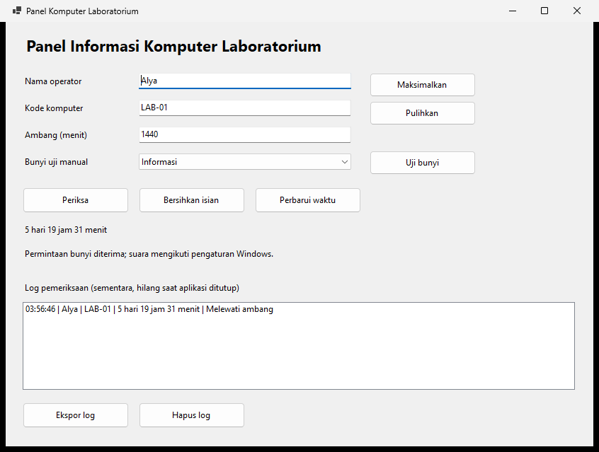

# Tugas Pertemuan 11: Panel Informasi Komputer Laboratorium

Mata kuliah Pemrograman Visual (TIF 3 031). Tugas individu.

## Kasus

Petugas laboratorium mencatat komputer yang diperiksa dan lama Windows telah berjalan. Petugas menentukan ambang dalam menit untuk membantu menentukan komputer mana yang perlu ditinjau. Ambang ini hanya aturan latihan, bukan ukuran kesehatan komputer yang sebenarnya.

Buat aplikasi **PanelKomputerLab**, Windows Forms VB.NET .NET 10, tanpa database. Log tersimpan sementara selama aplikasi terbuka.

## Kontrol

| Kontrol | Nama | Kegunaan |
|---|---|---|
| TextBox | txtOperator | Nama petugas |
| TextBox | txtKode | Kode komputer, misalnya LAB-01 |
| TextBox | txtAmbang | Ambang dalam menit |
| ComboBox | cboBunyi | Informasi/Peringatan untuk uji manual, DropDownList |
| Button | btnPeriksa | Memvalidasi, memeriksa waktu sistem, dan menambah log |
| Button | btnBersihkan | Mengosongkan isian tanpa menghapus log |
| Button | btnPerbarui | Membaca ulang waktu sistem |
| Button | btnUjiBunyi | Menguji bunyi dari cboBunyi |
| Button | btnMaksimalkan | Memaksimalkan jendela sendiri |
| Button | btnPulihkan | Memulihkan jendela sendiri |
| Label | lblWaktuSistem | Hari, jam, dan menit sejak sistem dimulai |
| Label | lblStatus | Hasil pemeriksaan/tindakan |
| ListBox | lstLog | Daftar pemeriksaan |
| ErrorProvider | errInput | Penanda input tidak valid |

Tambahkan judul dan Label untuk semua isian. Gunakan nama seperti `lblOperator`, `lblKode`, `lblAmbang`, `lblBunyi`, dan `lblLog`.

## Fitur wajib

1. **Struktur.** Deklarasi native dan konstanta ada di Module. Form mendukung Designer. Gunakan `IntPtr` untuk HWND dan `ULong` untuk hasil GetTickCount64.
2. **Validasi.** `Function ValidasiInput() As Boolean` menghapus error lama lalu memeriksa seluruh isian:
    - nama operator minimal 3 karakter setelah Trim;
    - kode tepat `LAB-` diikuti dua digit ASCII, misalnya LAB-01;
    - ambang berupa bilangan bulat 1 sampai 1440, diperiksa dengan Integer.TryParse;
    - jenis bunyi manual telah dipilih.
3. **Perbarui.** Baca GetTickCount64 saat aplikasi dibuka dan saat btnPerbarui diklik. Tampilkan sebagai hari/jam/menit. Perbarui tidak menambah log.
4. **Periksa.** Validasi dahulu. Jika valid, baca waktu terbaru dan tentukan status:
    - waktu sistem lebih kecil dari ambang: **Normal**;
    - waktu sistem sama dengan atau lebih besar dari ambang: **Melewati ambang**.

    Bandingkan milidetik dengan `CULng(ambang) * 60000UL`. Jangan hanya membandingkan komponen menit yang tersisa setelah Mod.
5. **Notifikasi.** Pemeriksaan Normal memanggil MessageBeep Informasi; Melewati ambang memakai Peringatan. cboBunyi hanya mengatur tombol Uji Bunyi manual. Jika permintaan bunyi gagal, tampilkan pesan tanpa menghilangkan hasil dan log pemeriksaan. Suara yang tidak terdengar tidak boleh langsung dianggap kegagalan API.
6. **Log.** Setiap pemeriksaan valid menambah satu item: waktu pemeriksaan, operator, kode komputer, lama sistem berjalan, dan status. Input tidak valid tidak menambah log atau memanggil bunyi pemeriksaan.
7. **Jendela.** Maksimalkan dan Pulihkan menggunakan ShowWindow pada `Me.Handle`. Jangan memperlakukan hasil False sebagai kegagalan umum.
8. **Bersihkan.** Kosongkan isian teks dan ErrorProvider, kembalikan pilihan bunyi ke Informasi, lalu fokus ke operator. Log tetap tersedia.

## Tantangan tambahan

1. Ekspor seluruh log ke berkas teks dengan SaveFileDialog dan penanganan IOException/UnauthorizedAccessException. Gunakan Finally untuk menutup penulis berkas, seperti P7.
2. Hapus seluruh log setelah konfirmasi. Memilih Tidak mempertahankan log.

## Pengujian

| Data/tindakan | Hasil |
|---|---|
| Operator kosong, LAB-1, ambang abc | Semua kesalahan ditandai; log tidak bertambah |
| Operator Alya, LAB-01, ambang 0 | Ambang ditolak |
| Operator Alya, LAB-01, ambang 1441 | Ambang ditolak |
| Ambang 1 dan 1440 | Keduanya diterima sebagai batas input |
| Waktu 59.999 ms, ambang 1 | Normal |
| Waktu 60.000 ms, ambang 1 | Melewati ambang |
| Waktu 60.001 ms, ambang 1 | Melewati ambang |
| Perbarui | Waktu dibaca ulang tanpa log baru |
| Bersihkan sesudah pemeriksaan | Isian kosong; log tetap ada |

Tiga nilai waktu pada tabel adalah data uji fungsi penentuan status, bukan nilai palsu untuk ditampilkan sebagai pembacaan komputer. Saat aplikasi berjalan normal, tetap gunakan GetTickCount64.

## Contoh tampilan

Tata letak boleh berbeda. Contoh kunci memuat fitur ekspor dan hapus log yang bersifat opsional.

## Ketentuan dan pengumpulan

1. Windows Forms VB.NET, .NET 10, `Option Strict On`.
2. Nama kontrol sesuai tabel dan form dapat dibuka di Designer Visual Studio.
3. Kumpulkan folder source code proyek beserta screenshot hasil pemeriksaan valid dan error validasi. Sertakan `.sln`, `.vbproj`, `.vb`, `.Designer.vb`, dan `.resx` jika ada. Folder bin/obj tidak diperlukan.
4. Tambahkan catatan singkat hasil pengujian, termasuk batas ambang dan keadaan suara Windows.
5. Unggah ke LMS **kelas.usu.ac.id**. Tenggat mengikuti pengumuman pengajar di LMS.

## Penilaian

| Aspek | Bobot |
|---|---:|
| Fungsionalitas sesuai spesifikasi | 25% |
| Struktur, penamaan, dan kualitas kode | 20% |
| Penerapan konsep VB dan Windows API | 20% |
| Interaksi komponen visual dan log | 20% |
| Validasi dan penanganan error | 10% |
| Ketepatan waktu dan dokumentasi | 5% |

Mengacu pada Rubrik Penilaian Tugas Praktik Coding dalam RPS.
